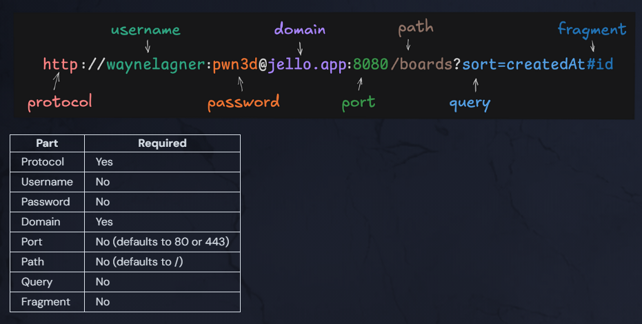
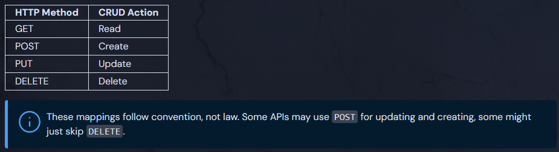

- [Sending and Receiving JSON](#sending-and-receiving-json)
	- [Decoding JSON](#decoding-json)
		- [Struct](#struct)
		- [Map](#map)
		- [json.Unmarshal vs json.Decoder](#jsonunmarshal-vs-jsondecoder)
	- [Encoding JSON](#encoding-json)
- [URIs](#uris)
	- [Deconstructing URLs](#deconstructing-urls)
- [Headers](#headers)
	- [Common Methods](#common-methods)
- [Methods](#methods)
	- [GET Requests](#get-requests)
	- [POST Requests](#post-requests)
	- [PUT Requests](#put-requests)
		- [POST vs. PUT](#post-vs-put)
	- [Delete Requests](#delete-requests)
	- [Status Codes](#status-codes)
		- [Non-Ok Responses](#non-ok-responses)
- [Paths](#paths)
	- [REST APIs](#rest-apis)
	- [URL Query Parameters](#url-query-parameters)
- [cURL](#curl)
	- [cURL GET Request](#curl-get-request)
	- [cURL POST Request](#curl-post-request)
	- [jq](#jq)
		- [Extract fields](#extract-fields)

# Sending and Receiving JSON

JSON travels over HTTP as bytes. When sending JSON, you encode a Go value into JSON bytes. When receiving JSON, you decode those bytes into a Go type.
- Receiving JSON → decode bytes into a Go type
- Sending JSON → encode Go value into bytes

The `encoding/json` package provides functions to parse JSON data into Go objects (unmarshalling) and convert Go objects into JSON data (marshalling).

## Decoding JSON

### Struct

When we receive JSON data in the body of an HTTP response, it comes as a stream of bytes. In Go, it's common to decode this JSON data into a struct (or a slice of structs). To do so, we typically define the struct's fields and their types beforehand, matching the structure of the expected JSON response.

Expected JSON response:
```json
[
    {
        "id": 1,
        "name": "Alice",
        "email": "alice@example.com"
    }
]
```

Structure to decode into:
```go
// The standard encoding/json package uses tags to map JSON fields to struct fields
type User struct {
    Id   int    `json:"id"`
    Name string `json:"name"`
    Email string `json:"email"`
}
```

After receiving the response, we can decode it into a slice of `User`s with the "address of" operator `&`:
```go
var users []User
decoder := json.NewDecoder(res.Body)    // creates a streaming JSON reader from the response body
err := decoder.Decode(&users)           // decodes into users
if err != nil {
    fmt.Println("error decoding response body")
    return    
}
```

If no error occurs, we can use the slice of items in our program:
```go
for _, user := range users {
    fmt.Printf("User – id: %v, Name: %v, Email: %v\n", user.Id, user.Name, user.Email)
    // User – id: 1, Name: Alice, Email: alice@example.com
}
```

### Map

Sometimes you have to deal with JSON data of unknown or varying structure in Go. In those instances `map[string]interface{}` offers a flexible way to handle it without predefined structs.

A JSON object is a key-value pair, where the key is a string and the value can be any JSON type. `map[string]interface{}` is a map where the key is a string and the value can be any Go type.

```go
var data map[string]interface{}
jsonString := `{"name": "Alice", "age": 30, "address": {"city": "Wonderland"}}`
json.Unmarshal([]byte(jsonString), &data)

fmt.Println(data["name"])  // Output: Alice
fmt.Println(data["address"].(map[string]interface{})["city"])  // Output: Wonderland
```

Rule of thumb: Use structs for known data models, such as API responses representing users or orders. Structs provide type safety, compile-time checks, and clearer code. Use maps for dynamic data where flexibility matters more than a predefined structure.

### json.Unmarshal vs json.Decoder

We can decode JSON bytes into a Go object using `json.Unmarshal` or a `json.Decoder`. The former is used when the JSON is already available as `[]byte`, while the latter reads JSON directly from a response body, since `resp.Body` implements `io.Reader` and provides a stream of bytes.

Using `json.Unmarshal`:

```go
import (
	"io"
    "fmt"
	"net/http"
    "encoding/json"
)

// Expected JSON response: [{"id": 1, "name": "Alice"}]
type User struct {
    ID   int    `json:"id"`
    Name string `json:"name"`
}

func getUsers() ([]User, error) {
	res, err := http.Get("https://api.jello.com/users")     
	if err != nil {
		return nil, fmt.Errorf("error making request: %w", err)
	}
    defer res.Body.Close()                  // close response body - not doing so can cause memory issues

	data, err := io.ReadAll(res.Body)       // reads the response body into a slice of bytes []byte 
	if err != nil {
		return nil, fmt.Errorf("error reading response: %w", err)
	}

    var users []User
    err := json.Unmarshal(data, &users)      // converts bytes to a slice of User structs
    if err != nil {
        return nil, fmt.Errorf("error decoding data: %w", err)
    }
	return users, nil
}
```

Using `json.Decoder`:

```go
import (
    "fmt"
	"net/http"
    "encoding/json"
)

// Expected JSON response: [{"id": 1, "name": "Alice"}]
type User struct {
    ID   int    `json:"id"`
    Name string `json:"name"`
}

func getUsers() ([]User, error) {
	res, err := http.Get("https://api.jello.com/users")     
	if err != nil {
		return nil, fmt.Errorf("error making request: %w", err)
	}
    defer res.Body.Close()                  

    var users []User
    decoder := json.NewDecoder(res.Body)    // res.Body implements io.Reader
    err := decoder.Decode(&users)           
    if err != nil {
        return nil, fmt.Errorf("error decoding data: %w", err)
    }
	return users, nil
}
```

## Encoding JSON

If there is a way to unmarshal JSON data, there must be a way to marshal it as well. The `json.Marshal` function converts a Go struct into a slice of bytes representing JSON data.

```go
type User struct {
    Id   int    `json:"id"`
    Name string `json:"name"`
}

user := User{
    Id:     1,
    Name:   "Alice",
}

data, err := json.Marshal(user)
if err != nil {
	log.Fatal(err)
}
fmt.Println(string(data))
// {"id":1,"name":"Alice"}
```

# URIs

URLs are the primary addressing system of the web. There are 8 main parts to a URL, though not all the sections are always present. Each piece plays a role in helping clients locate the resources they're looking for.



## Deconstructing URLs

URLs pack multiple pieces of distinct communication into one compact string. URL Parsing breaks this string into structured components (scheme, host, path, query parameters, fragment).

The `net/url` package is part of Go's standard library. You can instantiate a [URL struct](https://pkg.go.dev/net/url#URL) using `url.Parse` 

```go
parsedURL, err := url.Parse("https://homestarrunner.com/toons")
if err != nil {
	fmt.Println("error parsing url:", err)it wou
	return
}
```

and then you can extract components:

```go
parsedURL.Hostname()
// homestarrunner.com

parsedURL.Scheme
// https

parsedURL.Path
// /toons
```

Extracting components like the `Hostname`, `Scheme`, or `User` credentials allows you to sanitize input, validate trusted redirect domains, or ensure traffic uses secure protocols (`https` instead of `http`). For a more structured approach, we can wrap this in a function which parses URLs into a struct:

```go
type ParsedURL struct {
	protocol string
	username string
	password string
	hostname string
	port     string
	pathname string
	search   string
	hash     string
}

func newParsedURL(urlString string) ParsedURL {
	parsedUrl, err := url.Parse(urlString)
	if err != nil {
		return ParsedURL{}
	}
	
	password, _ := parsedUrl.User.Password()    //  returns two values: the password if set and whether it was set
	return ParsedURL{
		protocol: parsedUrl.Scheme,
		username: parsedUrl.User.Username(),
		password: password,
		hostname: parsedUrl.Hostname(),
		port:     parsedUrl.Port(),
		pathname: parsedUrl.Path,
		search:   parsedUrl.RawQuery,
		hash:     parsedUrl.Fragment,
	}
}
```

# Headers

An [HTTP header](https://developer.mozilla.org/en-US/docs/Glossary/HTTP_header) allows clients and servers to pass additional information with each request or response. Headers are just case-insensitive key-value pairs that pass additional metadata about the request or response.

HTTP requests from a web browser automatically carry with them many headers, including but not limited to:

- The type of client (e.g. Google Chrome)
- The operating system (e.g. Windows)
- The preferred language (e.g. US English)

As developers, we can also define custom headers in each request.

Headers are useful for several reasons from design to security, but most often headers are used for metadata about the request or response itself. [Authentication](https://auth0.com/intro-to-iam/what-is-authentication) is a common use case for headers. For example, when making an API request, you may need to include an authentication token to prove your identity. This information is not the request itself, but additional information that tells the server who is making the request and whether they are authorized to access the resource.

## Common Methods

HTTP headers are represented by the type `http.Header`, which is defined as: 
```go
type Header map[string][]string
```

Because it maps strings to slices of strings, a single header key can hold multiple values.

**Reading a Header (`.Get()`)**<br>
Returns the first value associated with the given key, or an empty string "" if the key is not present.

```go
// Works on both http.Request and http.Response
contentType := res.Header.Get("Content-Type")
apiKey := req.Header.Get("X-API-Key")
```

**Setting / Overwriting a Header (`.Set()`)**<br>
Sets the key to the provided value, replacing any existing values for that key.

```go
req.Header.Set("Content-Type", "application/json")
req.Header.Set("Authorization", "Bearer " + token)
```

**Adding Multiple Values (`.Add()`)**<br>
Appends a value to any existing values for that key rather than overwriting.

```go
req.Header.Add("Accept", "application/json")
req.Header.Add("Accept", "text/plain")
```

**Deleting a Header (`.Del()`)**<br>
Removes the header completely.

```go
res.Header.Del("Cache-Control")
```

# Methods

The primary purpose of HTTP methods is to indicate to the server what we want to do with the resource we're trying to interact with. At the end of the day, an HTTP method is just a string, like `GET`, `POST`, `PUT`, or `DELETE`, but by convention, backend developers write their server code so that the methods correspond with different "CRUD" actions.

The 4 most common HTTP methods map nicely to the CRUD actions:



## GET Requests

There are two basic ways to make a Get request in Go.

1. The simple but less powerful way: `http.Get`
2. The verbose but more powerful way: `http.Client`, `http.NewRequest`, and `http.Client.Do`

If all you need to do is make a simple GET request to a URL, `http.Get` will work:

```go
resp, err := http.Get("https://jsonplaceholder.typicode.com/users")
```

If you need to customize things like headers, cookies, or timeouts, you'll want to create a custom [`http.Client`](https://pkg.go.dev/net/http#Client), and [`http.NewRequest`](https://pkg.go.dev/net/http#NewRequest), then use the client's [`Do`](https://pkg.go.dev/net/http#Client.Do) method to execute it.

```go
client := &http.Client{
	Timeout: time.Second * 10,
}

req, err := http.NewRequest("GET", "https://jsonplaceholder.typicode.com/users", nil)
if err != nil {
	log.Fatal(err)
}

resp, err := client.Do(req)
```

## POST Requests

`POST` requests send data to a server. They are generally *not safe* methods to call multiple times because that would create duplicate records.

In Go, there are two ways to make a `POST` request:
1. [`http.Post`](https://pkg.go.dev/net/http#Post) 
2. [`http.NewRequest`] (preferred for greater flexibility)

`http.Post` works only for simple requests where `Content-Type` is the only header you care about, while `http.NewRequest` allows full configuration before sending.

```go
import (
	"bytes"
	"encoding/json"
	"net/http"
)

type Comment struct {
	Id      string `json:"id"`
	UserId  string `json:"user_id"`
	Comment string `json:"comment"`
}

func createComment(url, apiKey string, commentStruct Comment) (Comment, error) {
    // encode our comment as json
	jsonData, err := json.Marshal(commentStruct)
	if err != nil {
		return Comment{}, err
	}

    // create a new request
	req, err := http.NewRequest("POST", url, bytes.NewBuffer(jsonData))
	if err != nil {
		return Comment{}, err
	}

    // set request headers
	req.Header.Set("Content-Type", "application/json")
    req.Header.Set("X-API-Key", apiKey)

    // create a new client and make the request
	client := &http.Client{}
	res, err := client.Do(req)
	if err != nil {
		return Comment{}, err
	}
	defer res.Body.Close()

    // decode the json data from the response
	// into a new Comment struct
	var comment Comment
	decoder := json.NewDecoder(res.Body)
	err = decoder.Decode(&comment)
	if err != nil {
		return Comment{}, err
	}

	return comment, nil
}
```

Since we are sending data, it must first be in the right format to travel over the web (i.e., JSON bytes). That is why we marshal it. Then, we create a new `POST` request using `bytes.NewBuffer`, which creates an `io.Reader` (i.e., a reader that reads from a byte buffer) from the JSON data.

Next, we modify the request headers. The `Body` of the request is the payload sent to the server. The special `Content-Type` header tells the server the format of the body (`application/json` for JSON data in this example). We also set the `X-API-Key` header to provide the API key.

We then create a new `http.Client` and use its `Do` method to make the request. Finally, we decode the JSON data from the response body into a Go `Comment` struct and return it.

## PUT Requests

The HTTP `PUT` method creates or more commonly, updates the target resource with the contents of the request's body. Unlike `GET` and `POST`, there is no `http.Put` function. You will have to create an `http.NewRequest` that an `http.Client` can [`Do`](https://pkg.go.dev/net/http#Client.Do).

```go
import (
	"bytes"
	"encoding/json"
	"net/http"
)

func updateUser(baseURL, id, apiKey string, data User) (User, error) {
	fullURL := baseURL + "/" + id

	jsonData, err := json.Marshal(data)
	if err != nil {
		return User{}, err
	}

	req, err := http.NewRequest("PUT", fullURL, bytes.NewBuffer(jsonData))
	if err != nil {
		return User{}, err
	}

	req.Header.Set("Content-Type", "application/json")
	req.Header.Set("X-API-Key", apiKey)

	client := &http.Client{}
	res, err := client.Do(req)
	if err != nil {
		return User{}, err
	}
	defer res.Body.Close()

	var user User
    decoder := json.NewDecoder(res.Body)    
    err = decoder.Decode(&user)           
    if err != nil {
        return User{}, err
    }
	
	return user, nil
}
```

### POST vs. PUT

While POST and PUT are both used for creating resources, PUT is more common for updates and is idempotent, meaning it's safe to make the same request multiple times without changing the server state more than once. For example:

```
POST /users/bob (create bob user)
POST /users/bob (create duplicate bob user)
POST /users/bob (create duplicate bob user)
```

```
PUT /users/bob (create bob user if it doesn't exist)
PUT /users/bob (update bob user with the same data)
PUT /users/bob (update bob user with the same data)
```

## Delete Requests

The `DELETE` method does exactly what you expect: it deletes a specified resource.

```go
import (
	"net/http"
)

func deleteUser(baseURL, id, apiKey string) error {
	fullURL := baseURL + "/" + id

	req, err := http.NewRequest("DELETE", fullURL, nil)
	req.Header.Set("X-API-Key", apiKey)

	client := &http.Client{}
	res, err := client.Do(req)
	if err != nil {
		return err
	}
	defer res.Body.Close()

	return nil
}
```

## Status Codes

The `Status Code` of an HTTP response tells the client whether or not the server was able to fulfill the request. Status codes are 3-digit numbers that are grouped into categories:

- `100-199`: Informational responses. These are very rare.
- `200-299`: Successful responses. 
- `300-399`: Redirection messages. These are typically invisible because the browser or HTTP client will automatically do the redirect.
- `400-499`: Client errors. You'll see these often, especially when trying to debug a client application
- `500-599`: Server errors. You'll see these sometimes, usually only if there is a bug on the server.

The [`http.Response`](https://pkg.go.dev/net/http#Response) struct has a `.StatusCode` property that contains the status code of the response.

```go
func deleteLocation() error {
	url := "https://api.boot.dev/v1/courses_rest_api/learn-http/locations/52fdfc07-2182-454f-963f-5f0f9a621d72"
	req, err := http.NewRequest("DELETE", url, nil)
	if err != nil {
		return err
	}

	client := &http.Client{}
	res, err := client.Do(req)
	if err != nil {
		return err
	}
	defer res.Body.Close()

	if res.StatusCode > 299 {
		return fmt.Errorf("request to delete location unsuccessful")
	}
	return nil
}
```

**Common Status Codes**

- `200` - OK. This means that everything worked as expected.
- `201` - Created. This means that a resource was created successfully. Typically in response to a `POST` request.
- `301` - Moved permanently. This means the resource was moved to a new place, and the response will include where that new place is. Websites often use `301` redirects when they change their domain name, for example.
- `400` - Bad request. A general error indicating the client made a mistake in their request.
- `401` - Unauthorized. This means the client doesn't have the correct permissions. Maybe they didn't include a required authorization header, for example.
- `404` - Not found. You'll see this on websites quite often. It just means the resource doesn't exist.
- `500` - Internal server error. This means something went wrong on the server, likely a bug on their end.

### Non-Ok Responses

Even if the request is successful, the server may return a non-OK HTTP status code (e.g., 404 Not Found, 500 Internal Server Error). These responses need to be handled separately from network errors.

```go
res, err := http.Get("https://example.com/api/resource")
if err != nil {
    fmt.Println("a network error occurred")
    return
}
defer res.Body.Close()

if res.StatusCode != http.StatusOK {
    fmt.Println("status code != 200")
    return
}
```

A successful response usually has a status code of `http.StatusOK` (200), but it can be any code between `200` and `299`.

# Paths

## REST APIs

[REST](https://developer.mozilla.org/en-US/docs/Glossary/REST) is a set of conventions about how HTTP APIs should be built. A RESTful architecture is stateless, which means the server does not need to know what state the client is in, nor does the client need to know what state the server is in. Statelessness in REST is enforced by interacting with resources.

In a RESTful API, the last section of the path of a URL specifies the resource. For example, `users` in `https://api.boot.dev/v1/courses_rest_api/learn-http/users` identifies the users resource. HTTP methods such as `GET`, `POST`, `PUT`, and `DELETE` define the operation to perform on that resource.

## URL Query Parameters

A URL's query parameters appear after the path in the URL structure but are not always present - they're optional. For example, `q=boot.dev` in `https://www.google.com/search?q=boot.dev` is a query parameter. Like headers, query parameters are `key / value` pairs. In this case, `q` is the key and `boot.dev` is the value.

There can be multiple query parameters:

```
http://example.com?firstName=lane&lastName=wagner
```

In the example above:

`firstName` = `lane`
`lastName` = `wagner`

The `?` separates the query parameters from the rest of the URL. The `&` is then used to separate each additional pair of query parameters after that.

# cURL

`cURL` is a command-line tool for transferring data using various protocols, like HTTP and HTTPS. It's a favorite among developers. Among other things, developers use cURL for:

- **Quick testing**: make HTTP requests with a single command.
- **Automation**: can seamlessly be integrated into scripts and automation workflows.
- **Debugging**: easily see requests and responses.

Install cURL on Debian-based systems with:

```bash
sudo apt install curl
```

cURL supports a number of options and commands, outlined in their [tutorial page](https://curl.se/docs/tutorial.html). 

## cURL GET Request

The simplest cURL command makes a GET request to the provided URL, for example:

```bash
curl https://jsonplaceholder.typicode.com/users/1
```

The response body is written to stdout. Because the output is written to stdout you can combine it with other commands, e.g. redirecting the output to a file.

```bash
curl https://jsonplaceholder.typicode.com/users/1 > user1.json
```

## cURL POST Request

Making a `POST` request with cURL is almost as simple as a GET request. Use the` -X POST` option (not `-x`) to specify the request method and the `-d` option to pass data.

Here's how to make a POST request:

```bash
curl -X POST http://example.com/resource -d "param1=value1&param2=value2"
```

This command makes an HTTP `POST` request to `http://example.com/resource` with the data `param1=value1&param2=value2`. The server's response body is written to `stdout`.

If you need to send JSON data, use the `-H` option to set the `Content-Type` header and the `-d` option to pass the JSON data:

```bash
curl -X POST http://example.com/resource -H "Content-Type: application/json" -d '{"key1":"value1","key2":"value2"}'
```

## jq

[`jq`](https://github.com/jqlang/jq) is a powerful command-line tool for processing JSON data. It's a favorite among developers for working with JSON because it can:

- **Parse JSON**: easily read and extract data from JSON responses.
- **Manipulate JSON**: modify JSON data on the fly.
- **Filter JSON**: find exactly what you're looking for within large JSON structures.

Install on Debian-based systems (like Ubuntu/WSL) with:

```bash
sudo apt-get update
sudo apt-get install jq
```

### Extract fields

jq is frequently used with cURL to parse JSON responses directly from HTTP requests. For example, to fetch JSON data from an API and extract a field we can use the [object identifier index](https://jqlang.org/manual/#object-identifier-index):

```bash
curl https://jsonplaceholder.typicode.com/users/1 | jq .username
# "Bret"
```

To get a field from each element in an array you can use the [array/object value iterator](https://jqlang.org/manual/#array-object-value-iterator) `.[]`, which can in turn be combined with the identifier index:

```bash
curl https://jsonplaceholder.typicode.com/users | jq '.[].username'
# "Bret"
# "Antonette"
# "Samantha"
# "Karianne"
# "Kamren"
# "Leopoldo_Corkery"
# "Elwyn.Skiles"
# "Maxime_Nienow"
# "Delphine"
# "Moriah.Stanton"
```

To get multiple fields:

```bash
curl https://jsonplaceholder.typicode.com/users/1 | jq '.name, .email'
# "Leanne Graham"
# "Sincere@april.biz"
```